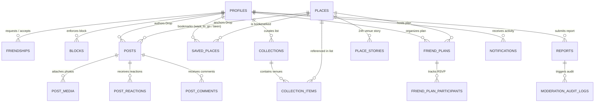

# ARCHITECTURE.md — Around Platform & Domain Architecture

## 1. Architectural Overview

Around is architected as a **modular mobile-first platform** backed by **Supabase (PostgreSQL 15 + PostGIS + Row-Level Security + Storage)**. Rather than premature microservices, we enforce clean **domain boundaries** inside a single canonical Flutter mobile codebase (`lib/`) and a versioned PostgreSQL schema (`supabase/migrations/00001` through `00006`).

## 2. Eight Capability Domains & Module Mapping

| Domain | Responsibility | PostgreSQL Schema (`supabase/migrations/`) | Flutter Modules (`lib/`) |
|---|---|---|---|
| **1. Identity** | Accounts, authentication, profiles, privacy preferences, account deletion | `auth.users`, `public.profiles`, `handle_new_user()`, `delete_own_account()` | `lib/features/auth/`, `lib/features/profile/`, `ProfileNotifier`, `SupabaseService` |
| **2. Social Graph** | Mutual friend requests, recipient-only acceptance, relationship states, blocks | `public.friendships`, `public.blocks`, `are_friends()`, `is_blocked()`, `enforce_friendship_transition()` | `FriendshipStatusesNotifier`, `FollowedFriendsNotifier`, `BlockedUsersNotifier` |
| **3. Places** | Tashkent venues, PostGIS `GEOGRAPHY(POINT, 4326)`, spatial & tag indexing, search | `public.places`, `get_nearby_places()` | `PlacesRepository`, `ExploreScreen`, `PlaceDetailScreen` |
| **4. Experiences** | Drops, photo uploads (`post-media`), ratings, tags, edit & delete lifecycle | `public.posts`, `public.post_media`, `recalculate_place_rating()` | `CreateDropSheet`, `PostsNotifier` (`publishDrop`, `editDrop`, `deleteDrop`) |
| **5. Discovery** | Friends Feed, Public Discovery, Place tabs, explainable recommendations | `get_friends_feed()`, `get_user_visible_drops()`, `get_recommended_places()` | `FeedScreen`, `ExploreScreen`, `PlacesRepository.getRecommendedPlaces` |
| **6. Collections** | Saved places (`want_to_go`, `been`), custom/shared lists, Friend Plans & RSVPs | `public.saved_places`, `public.collections`, `public.collection_items`, `public.friend_plans`, `public.friend_plan_participants` | `SavedScreen`, `SavedPlacesNotifier`, `SavedPlaceStatusesNotifier`, `FriendPlansNotifier` |
| **7. Trust & Safety** | Dual-layer RLS, visit privacy, blocking, reporting, 3-report quarantine, audit log | `public.reports`, `public.moderation_audit_logs`, `handle_post_report_quarantine()`, `enforce_post_rate_limit()` | `SettingsScreen`, `PostsNotifier.reportPost`, `AppLogger` |
| **8. Engagement** | Activity notifications, 24h Venue Stories, Drop reactions & comments, Quiet Hours | `public.notifications`, `public.place_stories`, `public.post_reactions`, `public.post_comments` | `NotificationsScreen`, `FeedScreen` story rail |

## 3. Domain Relationship Diagram (Workstream 0.3)

## 4. Migration Architecture (`supabase/migrations/`)

1. `00001_initial_schema.sql`: Core PostGIS extension, `profiles`, `places`, `friendships`, `posts`, `post_media`, `saved_places`, `blocks`, `reports`, `friend_plans`, `notifications`, `CHECK` constraints, and `GIST` / `GIN` indexes.
2. `00002_row_level_security.sql`: Dual-layer RLS policies on all core tables, `are_friends()` and `is_blocked()` helpers (restricted to `authenticated`), and `friendships_update_recipient_only` (`SEC-02`).
3. `00003_postgis_functions.sql`: `get_nearby_places` (spatial + category + `ILIKE` search), `get_friends_feed` (`SECURITY INVOKER` bound to `auth.uid()`, `SEC-01`), and `get_user_visible_drops` (`SEC-05`).
4. `00004_triggers_and_storage.sql`: `handle_new_user` auth trigger, `enforce_post_rate_limit` & `enforce_report_rate_limit` triggers (`SEC-08`), `handle_post_report_quarantine` (3-report auto-quarantine), `recalculate_place_rating`, `sync_place_saves_count`, `post-media` Storage bucket & RLS policies, and canonical Tashkent venue seeds.
5. `00005_security_and_rls_remediation.sql`: Idempotent corrective migration for upgrading previously deployed environments + `enforce_friendship_transition` trigger + `delete_own_account()` `SECURITY DEFINER` RPC (`TASK-09`).
6. `00006_platform_domains_and_discovery.sql`: Full platform schema for `collections`, `collection_items`, `friend_plan_participants`, `place_stories`, `post_reactions`, `post_comments`, `moderation_audit_logs`, and the explainable `get_recommended_places()` RPC.
