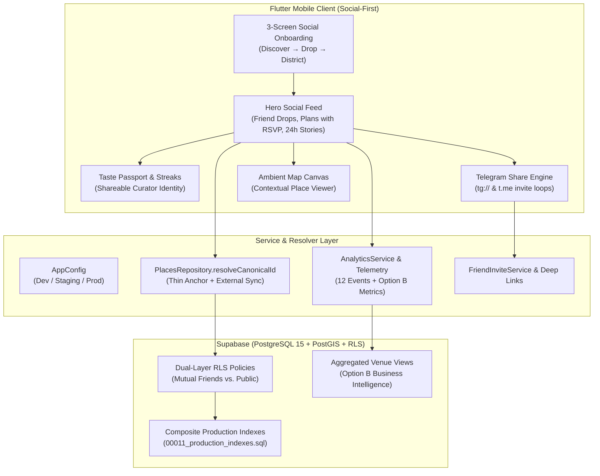

# Around — Option A Implementation Plan: The "Strava for Places" Playbook

**Status:** Architecture Specification & Execution Roadmap  
**Target Architecture:** Niche Social Network for Urban Life & Shared Tastes  
**Monetization Runway:** B2B Venue Analytics Portal (Option B)  
**Target Market:** Tashkent, Uzbekistan  
**Active Branch:** `feat/phase-12-strava-for-places`

---

## 1. Executive Summary & Strategic Invariants

### 1.1 The "Strava for Places" Mental Model
Yandex Maps (2.8M users, AI reviews, turn-by-turn navigation) and 2GIS (95% field-verified data, offline directory) own the utilitarian map in Tashkent. They answer: *"What is near me?"* and *"How do I navigate there?"*

**Around answers:** *"Where did my friends go that they actually loved?"* and *"Who wants to meet for coffee at Breadly tomorrow morning?"*

| Strava (Athletics) | Around (City Life & Places) |
|---|---|
| Run / Ride activity recording | **Place Drop** (photo + authentic note + rating) |
| GPS route & elevation profile | **Venue Spatial Anchor** (name, district, coordinates) |
| Kudos & athlete comments | **Reactions & Friend Comments** |
| Trophy Case, PRs & weekly mileage streaks | **Taste Passport**, district exploration stamps, curator rank |
| Follow athletes & training clubs | **Mutual Friend Circle** & collaborative **Friend Plans** |
| Strava does not manufacture GPS chips or build maps | Around does not maintain an exhaustive commercial directory; it anchors social memory to places |

### 1.2 Non-Negotiable Core Invariants
1. **The Social Feed is the Hero:** The app opens to the living heartbeat of your friend circle. The map is an ambient spatial viewer, not a directory search bar.
2. **Dual-Layer Privacy Model:** Drops default to `Friends Only` (`audience = 'friends'`), enforced at the PostgreSQL RLS layer. No broadcast surveillance.
3. **Telegram as the Primary Social Graph:** In Uzbekistan, Telegram is ubiquitous. Telegram invite links, native share sheets, and deep-link routing are our primary distribution engines.
4. **Option B Data Runway from Day 1:** Every user interaction generates structured, privacy-preserving venue affinity metrics (`AnalyticsService` and database views) so that when we launch the B2B Venue Analytics portal, cafe and restaurant owners have actionable intelligence to buy ($20–$50/month).

---

## 2. Architecture Overview: The 5 Structural Shifts



---

## 3. Workstream Breakdown

### Workstream 1: Hero Feed & Social Pulse Redesign (Mobile)

**Objective:** Transform the Home Feed from a simple list into an irresistible, Instagram-quality social feed of friends' city moments.

#### Architectural Changes
1. **Feed Composition (`lib/features/feed/screens/feed_screen.dart`):**
   - **Top Stories Rail:** 24-hour ephemeral venue stories from friends and favorite spots.
   - **Upcoming Friend Plans Ribbon:** Highlight active friend outings scheduled for today/this week with one-tap RSVP (`Going`, `Maybe`, `Can't Make It`).
   - **Chronological Friend Drops Feed:** High-aesthetic bento cards with photography, author avatar, sensory vibe tags, and friend reactions.
   - **"Caught Up" Celebration:** End-of-feed milestone encouraging users to create a Drop or invite friends on Telegram.
2. **Actionable Zero-State Handling:**
   - If user has 0 friends or friends haven't posted: Show **"Your circle is just getting started"** with one-tap **"Invite Friends on Telegram"** and a curated **"Tashkent Essentials"** sample drop reel.
3. **Navigation Rebalance (`lib/core/routing/app_router.dart`):**
   - Retain bottom navigation tabs: `Feed`, `Explore`, `Saved`, `Profile`.
   - The map tab (`Explore`) is treated as a spatial companion for weekend wandering, rather than the primary search entrypoint.

---

### Workstream 2: Telegram Social Graph & Frictionless Onboarding

**Objective:** Overcome the cold-start problem by plugging directly into Uzbekistan's primary communication channel.

#### Implementation Components
1. **3-Screen First-Run Onboarding (`lib/features/auth/screens/onboarding_screen.dart`):**
   - **Screen 1 — "Discover Through Friends":** Explain the difference between anonymous review apps and genuine friend recommendations.
   - **Screen 2 — "Your Privacy, Your Circle":** Clearly illustrate the Dual-Layer privacy toggle (`Friends Only` vs. `Public`).
   - **Screen 3 — "Your Tashkent Neighborhood":** Pick your home district (Mirabad, Yakkasaray, Yunusabad, etc.) + immediate Telegram friend invite prompt.
2. **Telegram Share Service (`lib/core/services/telegram_share_service.dart`):**
   - Formats rich Telegram messages:
     ```text
     ☕️ I'm tracking my favorite Tashkent cafes and bread spots on Around.
     Connect with me to see my private drops and Taste Passport:
     https://around.tashkent.app/invite/{code}
     ```
   - Uses `tg://msg_url?url=...&text=...` with automatic fallback to `https://t.me/share/url`.
3. **Deep Link Ingestion (`lib/core/services/deep_link_service.dart`):**
   - Routing:
     - `around://invite/:code` / `https://around.tashkent.app/invite/:code` → Opens `FriendInviteScreen` with one-tap friendship confirmation.
     - `around://passport/:username` → Opens `TastePassportScreen`.
     - `around://places/:slug` → Opens `PlaceDetailScreen`.

---

### Workstream 3: External Place Resolver & Thin Spatial Anchors

**Objective:** Never get bogged down maintaining a 5,000-venue directory. Treat venues as spatial anchors for social interactions.

#### Architectural Mechanics
1. **Canonical UUID & Slug Resolution (`PlacesRepository`):**
   - Places in our database are lightweight records: `id`, `canonical_uuid`, `name`, `district`, `latitude`, `longitude`, `category`, and `tags`.
   - Drops and saves reference `place_id`.
2. **On-the-Fly Venue Creation (`CreateDropSheet`):**
   - If a user visits a new cafe not in our seed list (e.g., a brand new specialty roaster in Shaykhontohur), they can create the Drop by typing the name and pinning coordinates.
   - The system creates the venue row automatically without administrative approval gates.
3. **External Metadata Enrichment:**
   - In future phases, `PlacesRepository` can fetch supplementary photos or opening hours via external APIs (OSM / Yandex Search API) on demand, keeping our database lean and purely focused on social interactions.

---

### Workstream 4: "Tastemaker" Gamification & Identity Loops

**Objective:** Give users a reason to drop places and check their profile every week (Strava's "athlete identity").

#### Features
1. **Shareable Taste Passport (`lib/features/profile/widgets/taste_passport_card.dart`):**
   - Curator persona badge (e.g., *"Specialty Coffee Enthusiast"*, *"Mirabad Night Owl"*, *"Sourdough Connoisseur"*).
   - District exploration progress (e.g., 3/5 Tashkent districts explored).
   - Top 3 frequented spots and sensory tags.
   - One-tap "Save Card Image / Share to Telegram Story".
2. **Exploration Streaks & Badges:**
   - "Weekend Explorer" badge (visited 2 new spots on Saturday/Sunday).
   - "District Tastemaker" (first in your friend circle to drop a spot in a new neighborhood).
3. **Followable Collections (`lib/features/saved_places/screens/saved_screen.dart`):**
   - Users can make collections public (e.g., *"Top 5 Quiet Cafes for Remote Work in Tashkent"*).
   - Friends can follow and save entire collections with one tap.

---

### Workstream 5: Option B Runway — Aggregated Venue Analytics

**Objective:** Collect structured commercial intelligence from Day 1 to build a high-margin B2B subscription portal for cafe owners.

#### Data Model & Telemetry
1. **Client-Side Telemetry (`AnalyticsService`):**
   - Every place view, save, drop, and plan triggers `trackVenueEngagement(placeId, type, atmosphereTag)`.
2. **Database Analytics Migration (`00013_venue_analytics_foundation.sql`):**
   - SQL view `venue_foot_traffic_hourly`: aggregates visit and drop frequency by hour of the day (0–23).
   - SQL view `venue_save_intent_summary`: counts total unique users who have saved the place to `want_to_go`.
   - SQL view `venue_district_reach`: calculates which neighborhoods the venue's visitors live in.
3. **Privacy Invariant:**
   - Zero personal identifiable information (PII) is exposed in venue views. Metrics are strictly aggregated counts, percentages, and peak hours.

---

## 4. Phased Execution Roadmap

| Task ID | Task Title | Primary Components | Dependencies | DoD Verification |
|---|---|---|---|---|
| **P12-01** | **AppConfig Environment Architecture** | `AppConfig`, `SupabaseService`, `.env` templates | `P11-04` | **DONE** (8 unit tests passing, clean analyzer) |
| **P12-02** | **Production Analytics & Venue Telemetry** | `AnalyticsService`, `AppLogger`, taxonomy | `P12-01` | **DONE** (5 unit tests passing, 12 events + Option B metrics) |
| **P12-03** | **First-Run Onboarding Redesign** | `OnboardingScreen`, `AppRouter`, Riverpod | `P12-02` | 3-step social flow, state persistence, widget tests |
| **P12-04** | **Telegram Social Graph & Invite Loop** | `TelegramShareService`, `FriendInviteScreen` | `P12-03` | Native `tg://` & `t.me` URL generation, deep link handling |
| **P12-05** | **Actionable Empty States UX** | `EmptyStateWidget`, `FeedScreen`, `SavedScreen` | `P12-04` | Zero blank screens; one-tap Telegram invite CTAs |
| **P12-06** | **Production Composite Indexes Migration** | `00011_production_indexes.sql`, RLS tests | `P12-01` | Composite indexes on `posts`, `saved_places`, `friendships` |
| **P12-07** | **Option B Aggregated Venue Analytics Views** | `00013_venue_analytics_foundation.sql` | `P12-06` | SQL views for foot-traffic hourly peaks & save intent |
| **P12-08** | **Hero Feed Social Polish & Friend Plans Ribbon** | `FeedScreen`, `FriendPlanRibbon`, `BentoCard` | `P12-05` | Active friend plans banner with 1-tap RSVP, story rail |

---

## 5. Cold-Start Playbook: The Tashkent 50-User Beta

A social network with zero friends is dead on arrival. To ensure density:

1. **Recruit 5 Natural Cohorts (10 users each):**
   - **Cohort 1:** Mirabad specialty coffee baristas & roasters (Breadly, B&B, Joydaman).
   - **Cohort 2:** Westminster International University in Tashkent (WIUT) student circle.
   - **Cohort 3:** Tech & startup expats living in Yakkasaray.
   - **Cohort 4:** Food bloggers & Tashkent food telegram channel admins.
   - **Cohort 5:** Coworking regulars (C-Space, GroundZero).
2. **Pre-Seeded Mutual Connections:**
   - Ensure each cohort member has all 9 other cohort members added as friends before the app goes public.
3. **Inaugural Social Event:**
   - Launch a shared Friend Plan: *"Saturday 10:30 AM — Breadly Sourdough & Lavender Matcha Tasting"* — inviting the beta cohort to RSVP, attend, and publish drops simultaneously.

---

## 6. Feedback & Decisions Requested

Before executing `P12-03` (Onboarding Redesign) through `P12-08`:
1. **Onboarding Screen Copy:** Are you aligned with the 3-step value prop: *"Discover Through Friends"* → *"Drop & Control Privacy"* → *"Pick Your District & Invite"*?
2. **Telegram Invite Incentive:** Should we award early invitees a special badge (e.g., *"Founding Tastemaker"*) on their Taste Passport card when they invite 3 friends?
