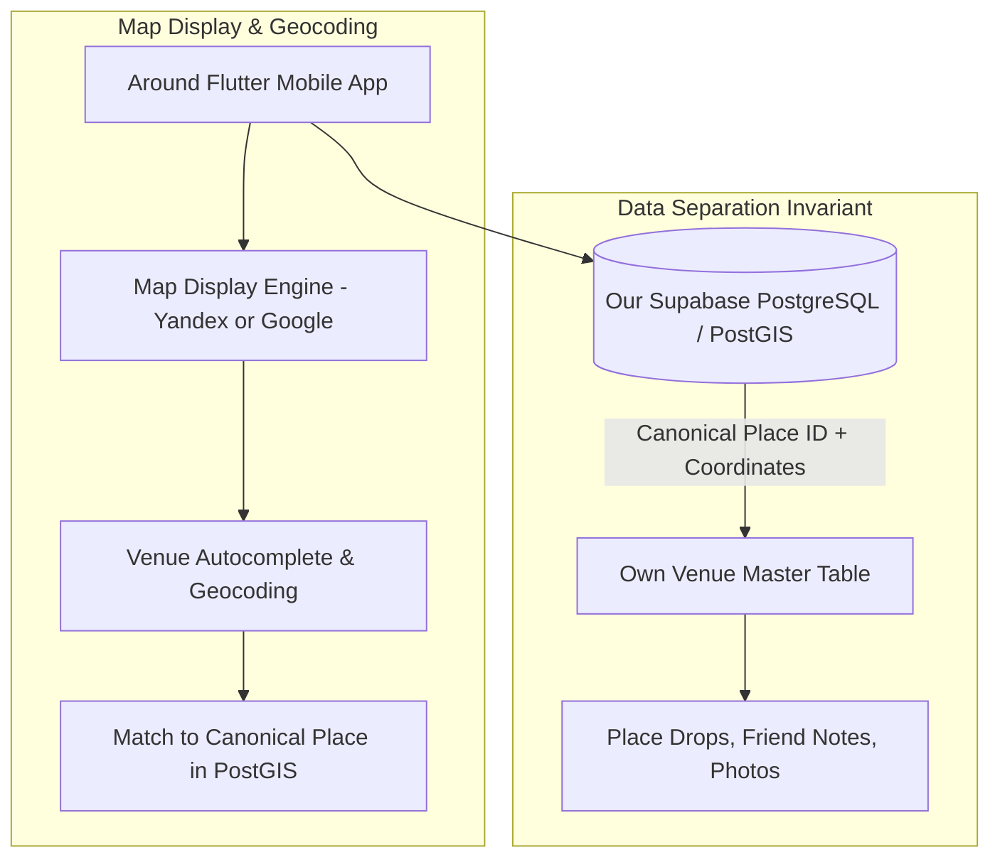

# Tashkent Map & Venue Data Provider Evaluation Framework

## Executive Objective
Before locking our production mapping SDK and Places API for the Around pilot in **Tashkent, Uzbekistan**, this document establishes the empirical evaluation criteria comparing **Yandex MapKit** vs. **Google Maps / Places API** vs. **Mapbox / OpenStreetMap**.

---

## 1. Provider Comparison Matrix

| Evaluation Dimension | Yandex MapKit & Places (GeoSearch) | Google Maps & Places API | Mapbox + OpenStreetMap |
| :--- | :--- | :--- | :--- |
| **Tashkent Venue Coverage** | **Dominant in Central Asia / CIS**. High coverage of local mahallas, teahouses, small coffee shops, and Cyrillic/Uzbek naming variations. | Strong coverage for major hotels, expat chains, and international venues; spotty for newly opened local indie spots. | Moderate coverage; relies on active community mappers. Missing opening hours and phone numbers. |
| **Search & Geocoding in Uzbek/Russian** | **Superior parsing** of localized address formats (e.g., "Yakkasaray district, Shota Rustaveli 14", "near Grand Mir Hotel"). | Good transliteration, but frequently fails on landmark-relative addressing common in Tashkent. | Weak search for localized micro-venues. |
| **Flutter Integration** | Official/community plugins available (`yandex_mapkit`). Supports interactive vector styling, custom pin clusters, polyline routing. | Official Flutter plugin (`google_maps_flutter`). High stability, extensive documentation, seamless vector rendering. | Excellent Flutter plugin (`mapbox_maps_flutter`). Full custom vector styling capabilities. |
| **Caching & Ownership Terms** | **Commercial GeoSearch License required** to store place metadata locally. | **Strict Caching Restrictions**: Terms prohibit storing place details/photos permanently (Place IDs are the only allowed persistent reference). | Permissive Open Data Commons / ODbL terms for OSM data. |
| **Cost at Scale** | Free tier available via Yandex Developer Console; tiered pricing suited for regional scale. | $17–$32 per 1,000 Places Details requests; can become expensive quickly for photo-heavy discovery. | $5.00 per 1,000 map loads; generous free tier (50,000 monthly active users). |

---

## 2. Empirical Benchmark Protocol (Sample Sample of 15 Tashkent Venues)

During the pilot kickoff, the team executes a manual query comparison across 15 real Tashkent venues:

### Target Venue Categories:
1. **Third-Wave Cafés & Coffee Roasters**:
   * *B&B Coffee House* (Shota Rustaveli)
   * *Ecorn* (Chekhov)
   * *Pie Republic*
   * *Tim's Coffee & Roastery*
   * *Socials Café* (Mirabad)
2. **Study Spots & Co-working Spaces**:
   * *C-Space Co-working* (Yakkasaray)
   * *GroundZero Kitob*
   * *Book Café* (Navoi Avenue)
3. **Local Eateries & Casual Dining**:
   * *Afsona Restaurant* (Taras Shevchenko)
   * *Rayhon National Meals*
   * *Chorsu Bazaar Samarkand Osh*
   * *Basri Baba Turkish Cuisine*
4. **Cultural & Evening Spots**:
   * *Ilkhom Theatre Café*
   * *Alisher Navoi Cinema Park*
   * *Broadway Street Artisan Alley*

### Scoring Criteria (1 to 5 points):
- **Accuracy of Pin Location**: Does the coordinate drop on the actual entrance or just the street center?
- **Street Address Accuracy**: Does it display correct house number and district?
- **Opening Hours Accuracy**: Are weekday vs. weekend hours up to date?
- **Response Latency from Tashkent ISPs**: Time to first byte (TTFB) over Uztelecom / Beeline UZ networks.

---

## 3. Recommended Hybrid Architecture

To maintain product speed without violating licensing terms or locking into a single vendor:

### Architectural Policy:
1. **We own the canonical venue ID**: Every venue has our internal UUID in PostgreSQL.
2. **Provider IDs are mapped as external references**: `external_provider_source = 'yandex' | 'google'` and `external_provider_id = '...'`.
3. If switching map providers later (e.g. expanding from Tashkent to London or Tokyo), our social graph, friend drops, and ratings remain 100% intact.
