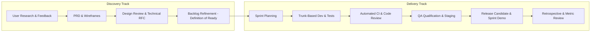

# Around Engineering Team Collaboration Standards & Ways of Working

## 1. Executive Summary & Purpose
This document defines the official engineering team collaboration standards, agile delivery cadence, and code governance policies for the **Around** mobile application engineering team. 

Our mission is to build a reliable, high-performance, places-first social discovery platform. Because Around centers on authentic personal recommendations, location privacy, and lightweight sharing, engineering excellence, rapid feedback loops, and uncompromised user trust are foundational.

---

## 2. Core Operating Principles

1. **User Trust & Privacy First**: Every architectural choice must respect our dual-layer privacy model (Friends-only vs. Public). We never leak location history or private visits without explicit user consent.
2. **Quality at the Source**: Quality is not inspected in by QA; it is built in by engineers. Automated tests, linting, type-safety, and PR reviews are mandatory gating criteria.
3. **Trunk-Based Delivery**: We avoid long-lived branches and merge hell. Small, cohesive pull requests (<400 lines of code) merge into `main` multiple times a day behind feature flags.
4. **Asynchronous by Default, High-Bandwidth When Blocked**: Documentation, clear PR descriptions, and RFCs enable distributed, focused deep work. Sync meetings are reserved for decision alignment and blockers.
5. **Blameless Post-Mortems & Continuous Learning**: Failures are systemic opportunities to improve automation, observability, and test coverage—never personal faults.

---

## 3. Team Structure & RACI Matrix

| Role | Primary Responsibilities | R (Responsible) | A (Accountable) | C (Consulted) | I (Informed) |
| :--- | :--- | :--- | :--- | :--- | :--- |
| **Product Manager (PM)** | Product requirements, user validation, backlog prioritization, release notes, success metrics. | PRD, User Stories, Acceptance Criteria | Product Scope & Prioritization | Architecture RFCs, UX Wireframes | Sprint Health, CI/CD Alerts |
| **Engineering Lead (EM/TL)** | Architecture integrity, delivery cadence, code review SLAs, technical debt management. | ADRs, Release Readiness, CI/CD Infrastructure | Technical Delivery & Production Stability | Product Roadmap, Design Specs | Customer Feedback |
| **Mobile Engineers (iOS/Android/Web)** | Screen implementation, client state management, offline persistence, animations, unit/integration tests. | Feature implementation, component tests, bug fixes | Feature Code Quality | PRDs, API Contracts | Release Schedule |
| **Backend / API Engineers** | Venue canonical records, geospatial queries, social graph, feed aggregation, privacy authorization. | Core APIs, database schema, data isolation enforcement | API Performance & Security | Client State Needs | Client Release Notes |
| **Product Designer (UI/UX)** | Design systems, interaction patterns, accessibility, user research, clickable prototypes. | Figma specs, micro-interaction guidelines, visual assets | Design System & Usability | Technical Feasibility, DoR | Build Status |
| **QA / Automation Engineer** | E2E automation test suites, performance benchmarking, release qualification, exploratory testing. | E2E test runs, regression sign-off, test data setup | Quality Gate Enforcement | Sprint Planning, Acceptance Criteria | Deployments |

---

## 4. Dual-Track Agile Cadence & Sprint Rituals

We operate on a **2-week sprint cycle** running two parallel tracks: **Discovery Track** (validating user problems, design, prototyping) and **Delivery Track** (building, testing, shipping hardened code).



### Sprint Rituals Schedule
- **Sprint Planning (Day 1, 09:30 - 11:00)**:
  - Goal: Commit to sprint backlog items meeting the *Definition of Ready*.
  - Output: Sprint Goal published in Slack/Notion, tasks estimated in Story Points (Fibonacci: 1, 2, 3, 5, 8).
- **Daily Standup (Mon-Fri, 09:45 - 10:00 - Max 15 mins)**:
  - Format: Focus on progress towards the Sprint Goal and blockers.
  - 3 Questions: What did I complete yesterday? What am I shipping today? What is blocking me?
  - Written async update in `#eng-standup` is encouraged if in flow.
- **Backlog Refinement / Grooming (Day 7, 14:00 - 15:00)**:
  - Review upcoming user stories for the next sprint. Clarify acceptance criteria, technical dependencies, and size tasks.
- **Sprint Demo & Review (Day 10, 15:00 - 16:00)**:
  - Working software demonstrated to cross-functional stakeholders. Live testing on real devices.
- **Retrospective (Day 10, 16:00 - 17:00)**:
  - Blameless reflection: What went well? What slowed us down? Action items assigned with concrete owners.

---

## 5. Definition of Ready (DoR) & Definition of Done (DoD)

### Definition of Ready (DoR) — Entering the Sprint
A user story or ticket can only enter a sprint if:
1. **User Value & Context**: Clear *As a [user], I want [action], so that [benefit]* statement.
2. **Acceptance Criteria (AC)**: Given-When-Then criteria defined (Gherkin format).
3. **Design Assets**: Final UI designs provided in Figma with responsive specs and edge states (loading, empty, error, offline).
4. **Privacy & Permission Classification**: Explicitly categorized as *Friends-only*, *Public*, or *Local-only*.
5. **Technical Dependencies**: Required backend API contracts defined or mocked.
6. **Estimated**: Story pointed by the delivery team.

### Definition of Done (DoD) — Shipping to Production
A feature or bug fix is strictly considered *Done* when:
1. **Code Complete**: Implemented according to TypeScript / architecture guidelines.
2. **Automated Testing**:
   - Unit & integration tests written and passing.
   - Code coverage threshold maintained (>= 80% on business logic).
   - Critical path verified by E2E test.
3. **Peer Review**: Approved by at least 1 senior peer; all review comments resolved.
4. **CI/CD Pipeline Green**: Clean compile, zero lint errors, type checks pass, security scans pass.
5. **Performance & Bundle Budget**: Zero memory leaks; app startup and interaction response times meet SLA (<16ms frame budget).
6. **Privacy Verification**: Confirmed that private location data/visits are never leaked in payload.
7. **Documentation**: Code comments updated; customer-facing release notes updated.
8. **Merged to `main`**: Deployed to Staging / Internal TestFlight track and verified.

---

## 6. Git Workflow & Branching Strategy

We enforce **Trunk-Based Development**. Long-running feature branches are prohibited.

### Branch Taxonomy
- `main`: Always production-ready, deployable source of truth.
- `feat/<ticket-id>-<short-description>`: Short-lived feature branch (lifetime: < 2 days).
- `fix/<ticket-id>-<short-description>`: Bug fix branch.
- `chore/<short-description>`: Dependency bumps, tool updates, refactors.
- `release/vX.Y.Z`: Release stabilization branch cut every 2 weeks.

### Conventional Commit Standard
All commit messages must adhere to the Conventional Commits specification:
```text
<type>(<scope>): <short imperative description>

[optional body explaining WHY, not WHAT]

[optional footer: Closes #ISSUE-ID, BREAKING CHANGE: ...]
```

Allowed types:
- `feat`: A new user-facing feature.
- `fix`: A bug fix.
- `perf`: A code change that improves performance.
- `refactor`: A code change that neither fixes a bug nor adds a feature.
- `test`: Adding missing tests or correcting existing tests.
- `style`: Changes that do not affect the meaning of the code (formatting, missing semicolons).
- `docs`: Documentation updates.
- `chore`: Build scripts, CI workflow updates, package upgrades.

*Example:*
```bash
feat(drop): add camera capture with live venue selector

Allows users to upload custom venue moments with optimistic feed update.
Closes #AROUND-142
```

---

## 7. Code Review Standards & Turnaround SLAs

### Code Review Turnaround SLA
- **Standard PR (< 400 lines)**: Reviewed within **24 hours**.
- **Hotfix / P0 Blocker**: Reviewed within **1 hour**.
- **RFC / Architectural Proposal**: Reviewed within **48 hours**.

### Pull Request Rules
1. **Size Limit**: Maximum 400 lines of code change (excluding generated lockfiles/mocks). Larger tasks must be broken down into stacked PRs or feature flags.
2. **Self-Review First**: The author must inspect their own diff, run tests locally, and check the PR checklist before requesting review.
3. **Mandatory Approvals**:
   - Minimum 1 approval required for merging.
   - 2 approvals required for core security, payment, or privacy-critical subsystems.
4. **Reviewer Etiquette**:
   - Prefix comments with tags for clarity:
     - `[Nit]`: Non-blocking suggestion (formatting, minor naming).
     - `[Question]`: Seeking clarification, non-blocking.
     - `[Blocker]`: Must be resolved before merge (logic bug, missing test, security issue).
     - `[Praise]`: Recognize clean patterns, elegant solutions, or great tests.

---

## 8. Architectural Decision Records (ADR) & RFC Process

When proposing significant architectural changes, new third-party dependencies, or breaking API changes:
1. **Create an RFC**: Duplicate `docs/adr/000-template.md` to `docs/rfc/RFC-<name>.md`.
2. **Circulate for Feedback**: Post in `#eng-architecture` with a 48-hour review window.
3. **Adopt or Reject**: Tech Lead and relevant stakeholders approve.
4. **Persist as ADR**: Convert to `docs/adr/<number>-<decision>.md` documenting Context, Decision, Consequences, and Alternatives considered.
