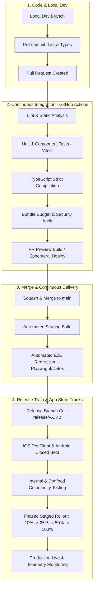
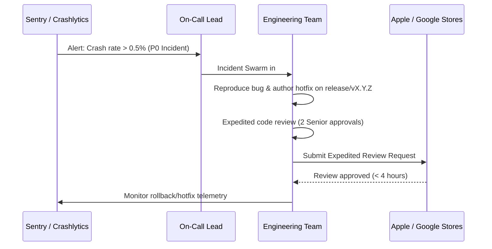

# Around Mobile App Delivery Process & Release Management

## 1. Delivery Pipeline Architecture

The delivery process translates product ideas into verified, production-hardened mobile builds. Our pipeline is fully automated via CI/CD, providing fast feedback to developers while guaranteeing that every release candidate undergoes rigorous quality, privacy, and security checks.



---

## 2. Multi-Environment Topology

We maintain four strictly isolated environments to safeguard production data integrity:

| Environment | Purpose | Target Audience | Data Source | Update Frequency |
| :--- | :--- | :--- | :--- | :--- |
| **Local (Dev)** | Active feature development & rapid prototyping | Developer | Local Mock / Seeded SQLite / Mirage | On file save (Vite HMR) |
| **Staging / PR** | Integration testing & designer sign-off | Engineering, QA, Design | Synthetic Staging DB | Every commit to `main` & PR ephemeral |
| **Beta (TestFlight & Play Console Internal)** | Pre-release regression & 20-30 user university validation cohort | Beta Community, Dogfooders | Staging / Scrubbed Sandbox | Bi-weekly release train |
| **Production** | Live consumer experience | All public users | Production DB with multi-region CDN | Bi-weekly staged rollout |

---

## 3. Testing Pyramid & Quality Standards

We enforce a balanced testing pyramid:

```mermaid
pyramid
    title Testing Pyramid
    "E2E Smoke & Critical Paths (5-10%)\nDetox / Playwright / Real Device"
    "Component & Integration Tests (25-30%)\nReact Testing Library & Store Interaction"
    "Unit Tests (60-70%)\nPure functions, privacy filters, models, algorithms"
```

### 1. Unit Tests (Vitest)
- Pure business logic: distance calculations, privacy filtering (verifying friends-only content is scrubbed from public queries), recommendation scoring, date formatting.
- Fast execution: < 100ms per test file; run on every commit.

### 2. Component & Screen Integration Tests
- Verify user interactions: creating a Place Drop, switching tabs (Feed vs. Explore), filtering saved places, toggling privacy flags in Settings.
- Mock network layer and storage to test error states, empty states, and offline mode.

### 3. End-to-End (E2E) Smoke Tests
- Critical user journeys:
  1. *Onboarding to Feed*: Launch app -> Complete 3-step onboarding -> Follow 5 friends -> Verify feed shows friends' drops.
  2. *Create Drop*: Tap Drop button -> Choose photo -> Select venue -> Add note & tag -> Set audience to *Friends* -> Publish -> Verify drop appears in feed with lock badge.
  3. *Explore & Place Detail*: Open Explore -> Tap pin on map -> Tap venue card -> Verify canonical place page loads -> Save venue -> Verify venue in Saved tab.
  4. *Privacy Boundaries*: Toggle "Keep visits private" -> Verify user visits cannot be queried publicly.

---

## 4. Mobile Release Train Cadence (Bi-Weekly)

To maintain momentum and predictability, we follow a **strict time-based Release Train**. Features that miss the train catch the next one behind a feature flag.

```text
Week 1 (Build & Polish):
  Mon - Thu: Trunk development behind feature flags
  Fri 17:00: Feature Freeze & Release Branch cut (release/v1.2.0)

Week 2 (Stabilization & Rollout):
  Mon 10:00: Build submitted to Apple TestFlight & Google Play Internal Track
  Tue: QA regression pass, bug fixes cherry-picked to release branch
  Wed: Release Candidate (RC) approved by PM and Tech Lead
  Thu 09:00: Submitted to App Store Review & Google Play Review
  Fri 10:00: Phased rollout begins (10% Day 1 -> 25% Day 2 -> 50% Day 4 -> 100% Day 7)
```

### Staged Rollout Strategy
Every production release starts at **10% rollout**. During staged rollout, our observability team monitors:
- Crash-free session rate (Target: >= 99.8%)
- API error rates (Target: < 0.1% 5xx errors)
- P95 Client latency (Target: < 200ms screen transition)

If crash rate exceeds 0.2%, the rollout is paused immediately.

---

## 5. Feature Flagging Strategy

All major features are deployed behind remote configuration feature flags (e.g., LaunchDarkly / Unleash / Firebase Remote Config):
1. **Trunk Safety**: Code merges to `main` safely in an inactive state.
2. **Targeted Beta Testing**: Flags can be enabled specifically for our 20-30 pilot university cohort.
3. **Instant Kill Switch**: If a new feature causes crashes or latency spikes in production, it can be disabled instantly without requiring an App Store review cycle.

---

## 6. Hotfix Escalation Protocol (P0 / P1)

When a critical defect is detected in production (e.g., data leak, app crash on launch):



- **P0 SLA**: Fix authored, verified, and submitted within **2 hours**.
- **Post-Incident**: Mandatory blameless post-mortem published within 48 hours.

---

## 7. App Store Compliance & Privacy Checklist

Before any submission to Apple App Store or Google Play:
- [ ] **App Store Review Guideline 5.1 (Data Privacy)**: Explicit in-app explanation for camera, photo library, and location permissions.
- [ ] **Account Deletion & Data Export**: Self-serve "Delete Account" button available directly in Settings.
- [ ] **User Safety Controls (UGC)**: Every user-submitted Place Drop has an in-app "Report" and "Block User" action with 24-hour moderation response.
- [ ] **Zero Live Location Tracking**: Confirm no background GPS tracking permission is requested.
- [ ] **Privacy Manifest**: Complete `PrivacyInfo.xcprivacy` with accurate API declared reasons.
