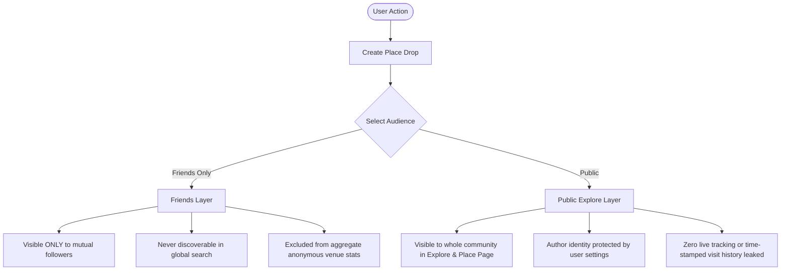

# Around Privacy, Security & Content Moderation Governance

## 1. Core Privacy Philosophy
Around is designed on the foundational belief that **people-first discovery must never compromise personal safety or privacy**. Unlike conventional social networks that track continuous user coordinates, Around enforces strict data isolation between private social circles and the public explore layer.

---

## 2. Dual-Layer Data Separation Model

### Architectural Invariants
1. **Friends-Only Invariant**: A drop marked `friends` is strictly query-gated by mutual follower permissions. Database queries enforce row-level security (RLS) so that unauthenticated or non-connected users can never fetch private drops even via crafted API calls.
2. **No Background Location Tracking**: Around only accesses location when the user explicitly triggers venue search or opens the map. Continuous background location tracking is strictly forbidden in code.
3. **Visit History Isolation**: Users can review places without exposing their complete real-time itinerary. The setting *"Keep my visits private"* ensures their profile never aggregates a chronological timeline of where they have been.

---

## 3. User Safety & Content Moderation Framework

User-generated content (photos, notes, reviews) must remain helpful, authentic, and safe. We enforce a **Zero-Tolerance Policy** for harassment, hate speech, illegal activities, and privacy violations.

### 1. In-App User Controls
- **Block User**: Instantly hides all drops, comments, and profile information from the blocked user, and prevents them from seeing the blocker's profile or content.
- **Report Content**: Available on every Place Drop and Venue page. Categorized as:
  - Inappropriate photo or text
  - Spam or promotional shilling
  - Wrong venue / inaccurate location
  - Harassment or privacy violation

### 2. Moderation SLA & Takedown Protocol
- **High Priority Reports (Harassment/Privacy)**: Actioned by moderation team within **2 hours**.
- **Standard Reports (Spam/Accuracy)**: Actioned within **24 hours**.
- **Automated Quarantine**: Any drop receiving 3+ unique user reports is automatically quarantined from the Public Explore feed pending human moderation review.

---

## 4. Regulatory Compliance (GDPR, CCPA & App Store)

| Requirement | Implementation in Around |
| :--- | :--- |
| **Right to Access / Data Portability** | Users can export their profile data, drops, and saved places in standard JSON format via Settings -> Privacy -> Export My Data. |
| **Right to Erasure (Forget Me)** | 1-click self-serve account deletion removes all profile data, photos, drops, and saved items within 30 days of request. |
| **Consent & Opt-in** | Granular permissions requested just-in-time (e.g., photo library access requested only when tapping the camera button). |
| **Data Retention** | Ephemeral cached location coordinates discarded immediately after venue search resolves. |
